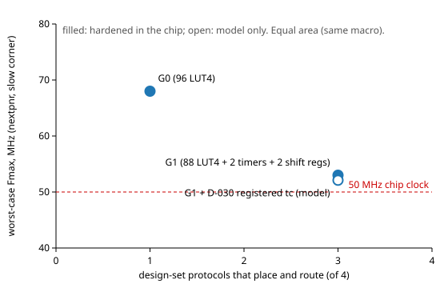

# Architecture comparison at equal area (phase 3)

**Historical report, September 28, 2026.** The numbers below retain the original
local compiler/model and specialization measurements; they are not a current
paired hosted measurement. Physical-build CI IDs establish the named builds,
not every compiler or component-area number in this table. See the
[current refresh](architecture_refresh_20261015.md) for its separate status.

**Date:** 2026-09-28 · **Rule:** D-004 requires equal total area and the same clock target (50 MHz). The historical G0/G1 comparison uses the same shell and fabric macro outline (1016.64 × 669.06 µm), placement and configuration interface, replacing one 4 × 3 tile slot. Those matched physical boundaries do not establish identical internal routing or configuration-storage costs. The primitive-tile standard-cell ratio recorded in D-026 is a historical local estimate, not a freshly authenticated area result. **Metrics:** coverage = design-set protocols that place and route on the fabric (of 4: UART, SPI controller, I2C controller, I2C target); performance = the worst nextpnr Fmax estimate among those that fit (slow corner, timing model of `tools/timing/README.md`; a model, not a physical rate).

| Variant | Built? | Fabric logic | Fits | Logic cells (UART / SPI / I2C ctrl / I2C target) | Worst Fmax (MHz) | Evidence |
|---|---|---|---|---|---|---|
| **G0** | hardened in the chip (CI 36353540402) | 96 LUT4 | 1 of 4 (SPI) | 124 / **86** / 115 / 184 | 68.0 (SPI) | `docs/reports/g0_results.md` |
| **G1** | hardened in the chip (CI 36376994834) | 88 LUT4 + 2 timers + 2 shift registers | **3 of 4** | **29 / 47 / 70** / 169 | 53.0 (I2C controller) | `docs/reports/g1_results.md`, D-026 |
| G1 + registered terminal count (D-030) | primitive RTL proven (F4); timing from STA, not hardened | same as G1 | 3 of 4 | same as G1 | 52.1 (I2C controller); UART 90.7 → 100.5 | D-030 |
| G1 + primitive tile with design repair (D-031) | not feasible (tile placement fails) | - | - | - | - | D-031 |
| G1 + LUT tiles with 2 control sets | not built | - | would not change fits: 3–7 control sets per design vs 11 LUT tiles | - | - | `docs/reports/g1_limits.md` |
| G1 + second primitive tile | not built | 80 LUT4 + 4 + 4 | design set uses ≤ 2 + 2 blocks; the I2C controller (70 LCs) would be at 88 % of 80 | - | - | `docs/reports/g1_limits.md` |
| G1 + register-file tile (D-034) | measured by synthesis (tile library `RAM_32x4_2R_1W` ×2) | 80 LUT4 + register file | 3 of 4: I2C target 123 LCs (4 registers) / 110 (2) of 80 | - | - | D-034 |

## What the comparison says

- **The historical compiler comparison reports three fitting protocols on G1 and one on G0**, within matched macro outlines and at a common 50 MHz assessment target. G1 exchanges 8 LUT4s for hard primitives. Its 53 MHz worst model estimate is for I2C controller, whereas G0's 68 MHz is for SPI, so those aggregate values do not compare the same workload. These observations do not establish a new physical area or timing advantage.
- **The examined historical candidates did not establish a better overall design-set result than G1 under that selection method.** D-030 improves UART's model estimate but not the slowest fitting design; D-031 fails placement. The unbuilt candidates remain projections from the recorded resource/control-set data, not measured replacement chips.
- **Open limits** that a different fabric would have to address: the I2C target (about twice G1's logic) and the I2C controller's timing margin (53 MHz model estimate vs 50 MHz).

## Not covered here
- The held-out protocols (phase 4) are not in these numbers, by design (D-003). Whether G1's primitives generalize is phase 4's result, measured on the frozen chip against a G0 build.
- Matched macro outlines do not independently measure equal internal routing cost, configuration-storage cost or power. No new total-area or power measurement is provided here, and unbuilt rows do not inherit physical qualification from G0 or G1.
